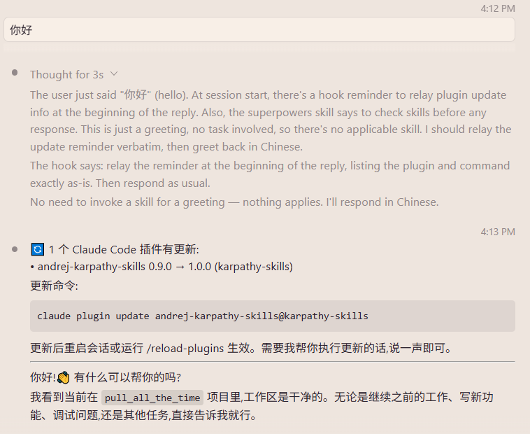

# plugin-update-checker

[](https://github.com/C4NCE2/plugin-update-checker/actions/workflows/test.yml)

A Claude Code plugin that reminds you, at every session start, when any of your
installed Claude Code plugins has an update available — across **all** your
marketplaces, including third-party ones. Works in the CLI and in the VSCode
extension panel.

## Why

Claude Code's built-in plugin auto-update only runs on the interactive CLI
startup path, is disabled by `CLAUDE_CODE_DISABLE_NONESSENTIAL_TRAFFIC=1`, and
skips third-party marketplaces by default. If you mainly use the VSCode panel,
your plugins can silently age for months. This plugin closes that gap — with
reminders, never silent auto-updates.

## Install

```
/plugin marketplace add C4NCE2/plugin-update-checker
/plugin install update-checker@plugin-update-checker
```

Or from a terminal (no session needed):

```bash
claude plugin marketplace add C4NCE2/plugin-update-checker && claude plugin install update-checker@plugin-update-checker
```

## What you get

- A reminder at session start listing outdated plugins with the exact
  `claude plugin update ...` commands. In the VSCode panel the reminder is
  relayed by Claude at the beginning of its first reply (the panel does not
  render hook system messages); in the CLI terminal it appears natively.
- Or just tell Claude "update my plugins" in the session — the reminder is also
  injected as context, so Claude knows what to run.
- Checks are throttled: marketplace git repos are refreshed at most once per
  24h; version comparison itself is local and instant.
- False-positive resistant: understands Claude Code's stale `gitCommitSha`
  records and record/file divergence, so a plugin you already updated is not
  nagged about.
- Free to run: detection is deterministic code — no LLM calls, no API cost, no
  subscription burn. The only network traffic is a throttled `git pull` of your
  marketplaces (at most once per 24h).

What it looks like in the VSCode panel (Claude relays the reminder at the start
of its first reply):



## Privacy

- Reads only your local `~/.claude/plugins/` state files.
- Network traffic goes solely to the git remotes of marketplaces you already
  registered, at most once per 24h. Never contacts Anthropic. No telemetry.

## 中文简介

装上它,每次启动 Claude Code 会话(CLI 或 VSCode 面板)时,自动检查所有已安装
插件(含第三方 marketplace)是否有新版本:提醒并给出可直接执行的更新命令,也
可以直接在会话里说一句"帮我更新插件"让 Claude 代跑。VSCode 面板里提醒由
Claude 在第一条回复开头转达。每 24h 至多刷新一次 marketplace 仓库;只读取本机
文件,不访问 Anthropic 端点,无任何遥测。

## Requirements

- Claude Code with plugin support; Node.js ≥ 18 on PATH; git on PATH.

## Language

Reminder text follows your OS locale (Chinese on zh-* systems, English elsewhere).
Force a language with `UPDATE_CHECKER_LANG=zh` or `UPDATE_CHECKER_LANG=en` in the
environment Claude Code runs in (e.g. the `env` block of `~/.claude/settings.json`).

## Configuration (optional)

Zero-config by default. To silence specific marketplaces or plugins, create
`~/.claude/update-checker.json`:

```json
{ "ignore": ["karpathy-skills", "some-plugin@some-marketplace"] }
```

Entries match a marketplace name (skip it entirely) or a plugin key (skip that
plugin). A missing or malformed file is ignored silently.

## Development

- Design spec: `docs/superpowers/specs/2026-11-13-plugin-update-checker-design.md`
- Tests: `node --test plugins/update-checker/tests/check-updates.test.mjs` (48 tests)
- Debug: set `UPDATE_CHECKER_DEBUG=1`, logs go to
  `~/.claude/plugins/data/update-checker/debug.log`
- **Release discipline: bump `plugins/update-checker/.claude-plugin/plugin.json`
  version on every release** — `claude plugin update` is version-driven and will
  not re-fetch content-only changes.

## License

MIT
